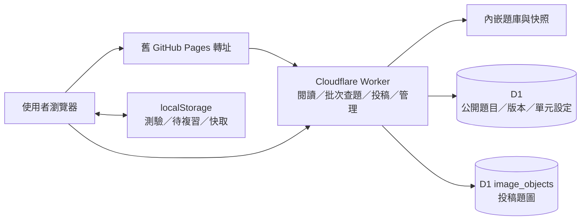

# 課程學習站

作業系統與演算法課程題庫，提供分單元閱讀、搜尋、遮答練習、單元測驗與答案解析。

**[開啟網站](https://course-library-submissions.orange06.workers.dev/course-library/)** · [批次查題](https://course-library-submissions.orange06.workers.dev/course-library/batch.html) · [投稿題庫](https://course-library-submissions.orange06.workers.dev/submit.html) · [題庫管理](https://course-library-submissions.orange06.workers.dev/review)

最近正式 Release：**[v1.3.0](https://github.com/yocheng06/course-library/releases/tag/v1.3.0)** · [所有 Releases](https://github.com/yocheng06/course-library/releases) · [本版更新說明](docs/releases/v1.3.0.md)

目前原始碼與公開題庫快照已更新至 **2026-11-27**。main 包含 v1.3.0 之後的更新，最新進度見 [11 月 27 日同步整理](docs/updates/2026-11-27-github-sync.md)、[系統架構](docs/architecture.md)，或 [v1.3.0 以後的完整提交差異](https://github.com/yocheng06/course-library/compare/v1.3.0...main)。

[測驗、備份與發布檢查改進](docs/improvements-20261104.md)：測驗語言與可調比例、手機篩選、完整備份、版本狀態及發布檢查。

## 主要功能

- 題目依單元、主題分組；相同前提的不同選項或填空版本連續排列，組內依「單選 → 多選 → 填空」排序。前提不同仍依原題型順序排列，可搜尋題目、答案與解析。
- 遮答練習與單元測驗支援選項隨機排列；相依選項保留原序，閱讀模式維持原有選項順序。
- 測驗作答自動暫存，重新整理後可繼續；每科保留最近一次已交卷結果，可查看錯題並直接重練。
- 批次查題支援 TXT、Markdown、JSON、CSV／TSV、HTML；完整符合才顯示已收錄與答案，未收錄可並排核對候選版本。
- 題目與答案 HTML 可配對匯入；自動建議主題，並支援勾選題目整批調整。
- 任何人可投稿及修正題目，修改後立即公開；保留歷史，管理者可還原修改與已移除題目。
- 管理區提供題庫健檢、缺解析與疑似重複清單、題圖連結檢查及版本比較。
- 完整題庫快照與瀏覽器快取可先顯示內容，背景同步最新投稿、修改及下架狀態。
- 支援深色模式、手機閱讀、字級調整、待複習標記及學習設定備份。
- 閱讀與遮答練習可勾選「隱藏英文題目」；只屏蔽純英文題，中英雙語與中文含英文術語的題目保留，來源資料及批次查題不變。
- 考後可自行勾選，將錯題與未答題整批加入待複習；預設不勾選，上次測驗也能使用。取消時只撤回本次新增標記。
- 可清除此單元或本課程待複習，清除前確認，並可復原上次清除；不刪題目或測驗紀錄。
- 管理者可新增單元、改名稱、拖拉排序；保留固定 ID，閱讀、查題與投稿同步使用單元資訊。
- 刪題經伺服器確認後立即更新畫面、題數及本機快取，再背景同步；舊同步結果不會覆蓋這次刪除。
- CPU 排程解析提供計算表與時間線，支援橫向捲軸及「往前／往後」按鈕。

- 管理登入可啟用手機驗證與一次性備援碼，並可登出其他所有裝置；安全細節及備份方式見 [管理安全說明](docs/updates/2026-11-18-security.md)。
- 批次查題可讀取已作答 HTML，逐題、逐格核對，並篩選需要檢查的題目。答案總表可補選投稿科目後轉入草稿。
- 投稿可一次選取題目與結果兩份 HTML，支援課程資料夾網址及測驗表單，缺少正解會列出要補的題號。
- 同題幹但選項不同的匯入版本各自收錄，陣列索引保留為題目條件，相同版本的答案衝突仍標示待核對。
- 題庫管理提供待核對原因、自動並排比較、批次影響範圍與匯入紀錄搜尋。訪客管理支援瀏覽器分組、暱稱、設備資訊與封鎖歷史。
- 演算法 L9「雜湊表／Hash Tables」60 題已逐題補強解析，包含新增的 7 題；19 題探測計算列出逐鍵碰撞、插入位置及最終表。依 9 個主題分組，各組按單選、多選、填空排序；原題與答案保留。
- 雜湊探測計算提供「上一步／下一步／重新開始／看完成結果」，每次探測分別顯示碰撞或插入，適用目前 19 題線性、二次與雙重雜湊題；閱讀、揭答及測驗交卷後皆可查看。未能完整辨認公式的版本僅保留文字解析。

## 使用方式

1. 從首頁選擇科目與單元，閱讀題目或使用搜尋。
2. 切換遮答練習或單元測驗，作答後對照正解與解析。
3. 將需要複習的題目加上標記，或從上次測驗直接重練錯題。

測驗暫存、上次結果、待複習標記與閱讀設定保存在目前瀏覽器，不會跨裝置同步；清除瀏覽器資料會一併移除。可從閱讀設定匯出其支援的學習資料備份。

## 架構總覽

學習頁、批次查題、投稿和管理由 **Cloudflare Worker + D1（含題圖）** 提供。舊 GitHub Pages 網址負責轉址。閱讀時先用網站隨附快照或上次瀏覽器快取，背景再讀公開 API。測驗與待複習保存在瀏覽器，公開題目與修改歷史保存在後端。

程式模組、資料流、權限與部署邊界見 [系統架構文件](docs/architecture.md)。原始碼不含正式資料庫、管理帳密、瀏覽器私人學習紀錄或全部投稿圖片；複製此 Repository 不會複製線上完整狀態。

## 本機使用與開發

下載專案並保留 `assets/`，在專案目錄執行 `python -m http.server 8000`，再開啟 `http://localhost:8000/`。投稿與管理功能使用上方的線上服務入口。

前端使用 HTML、CSS 與 JavaScript；開發時執行 `npm ci` 安裝套件，`npm test` 執行前端測試。網站題庫快照不包含管理帳號或私人修改歷史，最新公開題庫仍以線上同步資料為準。

2026-11-17 投稿服務移至站主自己的 Cloudflare，不再依賴 ChatGPT Sites 帳號。未啟用 R2 訂閱；部署與資料備份流程見 [Cloudflare 移植說明](contribution-service/CLOUDFLARE-MIGRATION.md)。

## 維護文件

- [系統架構與模組導覽](docs/architecture.md)
- [2026-11-04 進度、功能邊界與驗證](docs/updates/2026-11-04.md)
- [網站與題庫維護說明](docs/maintenance.md)
- [投稿與管理服務說明](contribution-service/README.md)
- [本次功能整合與驗證紀錄](docs/網站功能整合改良_20261102.md)

共同編輯、21 題解析與歷史備份保留：見 [2026-11-26 更新及備份操作](docs/updates/2026-11-26-edit-backup.md)。

投稿 HTML 可明確跳過缺少作答欄位的題目，其餘題目仍按內容配對正解：見 [匯入跳過操作說明](docs/updates/2026-11-27-import-skip.md)。

演算法 L10「動態規劃」目前 60 題均有解析，依主題及單選／多選／填空排序：見 [新增六題解析與單元名稱整理](docs/updates/2026-11-27-l10-completion.md)。原有 54 題核算保存在 [首次整理記錄](docs/updates/2026-11-27-algorithms-l10.md)。
