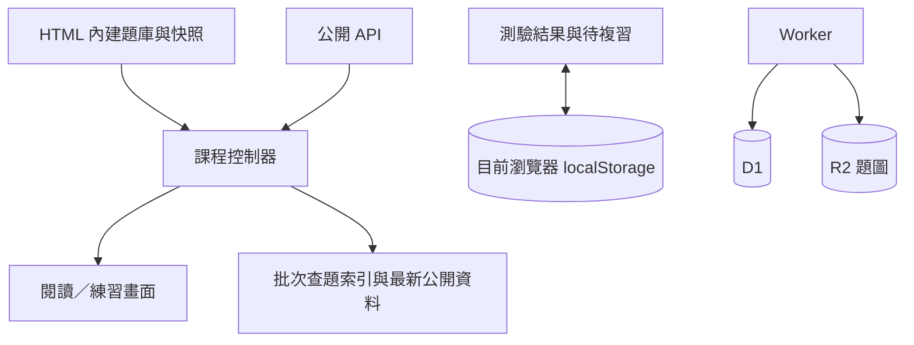

# 系統架構與程式導覽

整理日期：2026-11-04。以下依目前 Repository 程式整理；線上題數及投稿內容會持續變動，不固定寫在文件中。

## 1. 部署分為兩部分

| 部分 | 入口 | 職責 |
| --- | --- | --- |
| GitHub Pages 主站 | `index.html`、`os.html`、`algorithms.html`、`batch.html` | 選單元、閱讀、搜尋、遮答練習、測驗、批次查題 |
| 獨立投稿／管理服務 | `contribution-service/frontend/`、`worker/` | 投稿、編輯、可復原刪除、管理登入、歷史、題庫健檢、單元設定與題圖 API |
| 服務位址設定 | `assets/contributions-config.js` | 主站使用的公開 API origin；不放登入憑證 |

主站：[GitHub Pages](https://yocheng06.github.io/course-library/)。獨立服務：[投稿](https://course-library-submissions-yocheng06.yocheng06.chatgpt.site/submit.html)、[管理](https://course-library-submissions-yocheng06.yocheng06.chatgpt.site/review.html)。主站 `review.html` 導向服務；服務版管理介面由服務自身維護。

## 2. 從題庫到畫面的資料流

1. 主站 HTML 包含固定 ID 的內建題庫，以及隨網站發布的公開題庫快照。
2. `course-bootstrap.js` 比較快照與瀏覽器快取時間，先顯示可用內容。
3. 背景請求 `GET /api/questions?course=...`，取得公開投稿、內建題覆寫、合併 ID 對照及單元資訊；以 ETag／304 避免重複下載相同版本。
4. 課程控制器合併資料、套用解析與主題排序，重新整理題數與篩選。
5. 刪題成功時，`question-corrections.js` 發出已確認刪除事件；bootstrap 立即修補畫面與快取，並忽略刪除前開始的過期同步結果，再同步正式狀態。後端拒絕刪除時不先移除畫面。

快照是開站與離線閱讀的起點；最新公開狀態仍由 API 提供。GitHub 上的快照不會隨每次投稿自動產生 commit。

## 3. 前端模組

| 模組 | 主要檔案 | 說明 |
| --- | --- | --- |
| 課程頁 | `assets/os-learning.js`、`assets/algorithms-learning.js` | 單元切換、卡片、搜尋範圍、練習及對外共用介面 `window.courseLearning` |
| 題目共用邏輯 | `assets/question-tools.js`、`assets/choice-answers.js` | 題型、答案對應、搜尋、卡片更新、選項隨機排列與語言篩選 |
| 主題排序 | `assets/topic-order.js` | 同主題集中，再依單選、多選、填空排列；保留 ID |
| 載入與同步 | `assets/course-bootstrap.js`、`assets/sync-summary.js` | 快照／快取、API 同步、同步前後差異、已確認刪除更新 |
| 單元目錄 | `assets/unit-catalog.mjs`、`assets/unit-catalog-snapshot.mjs` | 初始完整單元目錄及背景更新，供投稿／查題等頁面使用 |
| 練習與學習資料 | `assets/practice-feedback.js`、`assets/practice-progress.js`、`assets/learning-tools.js` | 作答核對、本輪統計、待複習、清除與復原、備份 |
| 單元測驗 | `assets/course-exam.js` | 隨機抽題、選項換序、未交卷暫存、最近一次結果、錯題重練與選填的整批待複習 |
| 批次查題 | `assets/batch-ui.mjs`、`assets/batch-model.mjs`、`assets/batch-import.mjs`、`assets/batch-images.mjs` | 檔案解析、題幹與選項對應、填空及題圖比對 |
| 投稿 | `assets/contributions-submit.js`、`assets/grouped-submissions.mjs` | 題目／結果 HTML 配對、主題建議、分組、逐批送出、收據與重試 |
| 公開編輯 | `assets/question-corrections.js` | 讀取修訂號、儲存編輯、可復原刪除 |
| 管理 | `assets/library-manager.mjs`、`assets/library-health.mjs` | 列表、篩選、批次操作、版本比較、還原、健檢 |
| 解析輔助 | `assets/scheduling-walkthrough.js`、`assets/counting-sort-walkthrough.js`、`assets/selection-explanations.js` | CPU 時間線、計數排序步驟與選擇演算法解說 |

純英文題隱藏是閱讀與遮答練習的顯示篩選，不會刪來源、不改批次查題，也不改單元測驗抽題範圍。雙語題維持直接顯示，沒有逐題「查看英文原題」收合。

批次查題只在符合題幹、題型、選項／填空結構及答案對應等必要條件時套用答案；相似題作為候選顯示，不保證同題，也不直接猜答案。匯入查重與查題帶答案的目的不同，不能把「疑似重複」直接當成可用答案。

## 4. 後端與權限

後端入口：`contribution-service/worker/index.js`；共用正規化在 `worker/model.js`，管理功能拆在 `worker/builtin-management.js` 與 `worker/library-management.js`。

| 動作 | 權限／行為 |
| --- | --- |
| 讀公開題庫、單元、公開題圖 | 公開讀取 |
| 投稿新題、修改公開題目 | 免登入；通過格式、版本等檢查後公開 |
| 刪除公開題目 | 免登入的可復原移除，非永久刪除 |
| 管理清單、歷史、還原、匯出、健檢、單元設定 | 需管理者登入 |
| 已修改內容再次儲存 | 修訂號／來源雜湊防止覆寫較新版本 |

疑似重複或不同版本可另行收錄，保留狀態供管理者處理；完整重複略過。舊版待審核與勘誤端點仍為相容資料保留，不是新投稿的必經流程。

管理帳密由服務處理，密碼以 PBKDF2 雜湊保存；登入使用 HttpOnly／Secure／SameSite cookie。登入及初始設定仍有嘗試限制，不能把取消匿名操作的舊每小時 20 次限制解讀成所有防護都移除。

## 5. 儲存與資料邊界



- **GitHub**：程式、內建題庫、公開快照、解析整理、索引與文件；可重現隨版本發布的內容。
- **D1**：`submissions`、`public_questions`、`question_history`、`builtin_question_edits`、`unit_settings`、`unit_settings_history`，以及管理帳號、舊勘誤與內容更新狀態。定義在 `contribution-service/db/schema.js`，遷移在 `drizzle/`。
- **R2**：投稿題圖；API 依發布狀態與權限提供讀取。
- **localStorage**：題庫快取、閱讀設定、待複習、練習紀錄、未交卷暫存、每科最近一次測驗等。不同 origin、瀏覽器與裝置各自保存。

考後整批標記預設不啟用；取消勾選只移除本次新增的標記。清除此單元不受「搜尋全部單元」影響；清除此課程不影響另一科，復原只還原上次清除的標記。GitHub 原始碼壓縮檔不是 D1／R2 或個人學習紀錄備份。

## 6. 原始碼目錄

```text
course-library/
├─ index.html / os.html / algorithms.html / batch.html
├─ assets/                  # 前端程式、樣式、題庫索引與快照
├─ scripts/                 # 題庫整理、索引建立、稽核與快照工具
├─ content/                 # 解析整理及題庫內容記錄
├─ tests/                   # 前端／匯入／搜尋／測驗回歸測試
├─ docs/                    # 架構、維護、版本與進度文件
└─ contribution-service/
   ├─ frontend/             # 投稿服務資產與服務自身的管理頁
   ├─ worker/               # Worker API 與資料處理
   ├─ db/                   # Drizzle schema
   ├─ drizzle/              # SQL 遷移
   ├─ content/              # 已核對內容更新與合併資料
   ├─ scripts/              # 前端／題庫同步及 Worker 建置
   └─ tests/                # 權限、投稿、歷史與還原測試
```

## 7. 本機與發布

```sh
npm ci
python -m http.server 8000
# 開啟 http://localhost:8000/
```

原始碼不必先打包就可閱讀；投稿／管理仍使用設定的線上服務。不要用正式題庫做可寫入的測試。

若修改內建題目或投稿共用邏輯：

```sh
npm run sync:questions
npm --prefix contribution-service ci
npm --prefix contribution-service run build
npm --prefix contribution-service test
```

`sync:questions` 重新建立批次索引並同步服務需要的前端與題庫資料，會修改產物，必須檢查 diff。`build` 產生 `contribution-service/dist/`；不把 dist、node_modules、機密、正式資料庫或使用者匯出備份提交。

主站提交至 GitHub `main` 後由 Pages 發布；後端來源、建置封裝與 Sites 儲存版本／部署是另一條流程，只推 GitHub 不會部署 Worker。服務 `.openai/hosting.json` 保留原 project ID、D1 與 R2 綁定，不建立第二套正式服務取代原資料。

## 8. 驗證狀態

最新功能的測試與已知限制見 [2026-11-04 進度](updates/2026-11-04.md)。`npm test` 是全部前端測試入口，但目前含既有失敗，不能宣稱全套皆通過。版本紀錄會分開寫已驗證的選定測試與尚待整理的舊測試。
